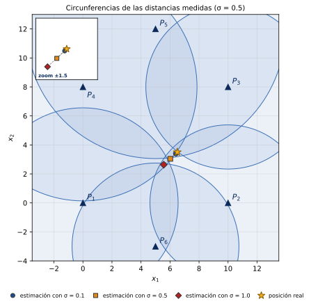

# Factorización QR, mínimos cuadrados y localización

Código en Python del póster **«Factorización QR, mínimos cuadrados y localización»**
(Andrés Zabaleta y Sara Zambrano · Álgebra Lineal 2 · Pontificia Universidad Javeriana, Bogotá).
Es el *Experimento en Python* (sección 6 del póster) y reproduce su **Tabla 1** y su **Figura 5**.

**Archivo principal:** [`experimento_localizacion.py`](experimento_localizacion.py)
(para copiarlo o descargarlo: ábrelo y usa *Raw* o *Download raw file*).



## ¿Qué hace?

Estima la posición de un punto desconocido (como un GPS) a partir de las distancias, medidas con error,
a seis puntos de referencia.

1. **Linealiza** el problema: al restar la ecuación del punto P1 a las demás desaparece el término
   no lineal ‖x‖² y queda un sistema sobredeterminado *Ax ≈ b* de tamaño 5×2 (Proposición 5).
2. **Factoriza** A = QR con Gram–Schmidt, programado desde cero (Teorema 3 y Proposición 3).
3. **Resuelve** R x̂ = Qᵀb por sustitución hacia atrás (Teorema 4). Ese x̂ es la solución de mínimos cuadrados.
4. **Repite** el experimento 1000 veces por cada nivel de ruido σ y mide el error E = ‖x_real − x̂‖.

Antes del experimento, el programa **comprueba con números** los resultados del póster:
A = QR, QᵀQ = I, QQᵀ es la proyección sobre range A (y no la identidad), R x̂ = Qᵀb da lo mismo que las
ecuaciones normales y que `np.linalg.lstsq`, el residuo es ortogonal a las columnas de A, la identidad de
Pitágoras del Teorema 4 y la falla de la unicidad cuando las referencias están alineadas.

## Cómo ejecutarlo

**En tu computador** (Python 3.8 o superior):

```bash
pip install -r requirements.txt
python experimento_localizacion.py
```

**Sin instalar nada (Google Colab, también desde el celular):** abre
[colab.research.google.com](https://colab.research.google.com), crea un cuaderno nuevo, sube
`experimento_localizacion.py` con el ícono de carpeta y ejecuta en una celda
`!python experimento_localizacion.py`. Las figuras quedan en la carpeta `resultados/`.

Opciones:

| Opción | Efecto |
|---|---|
| `--semilla 7` | otra realización del ruido (por defecto, la semilla del póster) |
| `--repeticiones 20000` | más repeticiones por nivel de σ (por defecto, 1000) |
| `--detalle` | muestra paso a paso un caso concreto: A, b, R, c = Qᵀb, la sustitución hacia atrás, x̂ y el residuo |
| `--sin-figuras` | solo números; no hace falta Matplotlib |
| `--mostrar` | abre las figuras en pantalla además de guardarlas |
| `--carpeta RUTA` | dónde guardar las figuras y el CSV (por defecto, `resultados/`) |

## Resultado: Tabla 1 del póster

Con la configuración por defecto el programa imprime exactamente la Tabla 1 del póster
(y marca con ✓ cada fila que coincide):

| σ | E medio (1000) | E medio / σ |
|---|---|---|
| 0 | 1×10⁻¹⁵ | — |
| 0.05 | 0.044 | 0.89 |
| 0.1 | 0.092 | 0.92 |
| 0.25 | 0.223 | 0.89 |
| 0.5 | 0.466 | 0.93 |
| 1.0 | 0.894 | 0.89 |

Y comprueba lo que afirma la sección 7 del póster:

- **Sin ruido** (σ = 0) el sistema es consistente: QR recupera la posición real con error ≈ 10⁻¹⁵.
- **Con ruido** el error medio crece casi proporcional a σ: E ≈ 0.90 σ.
  Es otro problema de mínimos cuadrados (una recta por el origen); la gráfica
  `resultados/error_vs_sigma.png` (se genera al ejecutar) lo muestra.
- **Ecuaciones normales:** en cada corrida ‖Aᵀ(b − Ax̂)‖ es del orden de 10⁻¹² (máximo observado
  3.9×10⁻¹²): es solo error de redondeo, es decir, el residuo es ortogonal a las columnas de A.
- **Factorizar una vez:** A solo depende de las referencias, así que se factoriza una única vez y
  Q, R se reutilizan en todas las repeticiones; solo cambia b.

## Correspondencia con el póster

| Póster | Función en `experimento_localizacion.py` |
|---|---|
| Proposición 5: A y b | `construir_A`, `construir_b` |
| Teorema 3 / Proposición 3: A = QR por Gram–Schmidt | `qr_gram_schmidt` |
| Sustitución hacia atrás (sección 4) | `sustitucion_hacia_atras` |
| Teorema 4: R x̂ = Qᵀb | `resolver_con_factorizacion`, `resolver_con_qr` |
| Proposiciones 2 y 4, Teoremas 2 y 4 | `verificar_teoria` |
| Sección 6: experimento y Tabla 1 | `experimento_monte_carlo`, `imprimir_tabla` |
| Sección 7: análisis | `comprobar_afirmaciones_del_poster`, `ajuste_error_vs_sigma` |
| Figura 5 | `figura_localizacion` |

El archivo está ordenado como el póster: primero el modelo (sección 5), luego QR (sección 3),
mínimos cuadrados con QR (sección 4), las verificaciones, el experimento y las figuras.

## Archivos que genera (carpeta `resultados/`)

- `figura_5_localizacion.png` y `.svg` (vectorial): referencias P1…P6, circunferencias de las distancias medidas (σ = 0.5),
  posición real, estimaciones con σ = 0.1, 0.5 y 1.0 y una ampliación (zoom) cerca de la posición real.
  Los tres σ usan los mismos errores ε, solo cambia la escala: así se ve cómo la estimación se aleja.
- `error_vs_sigma.png` y `.svg`: E medio contra σ con la recta E ≈ kσ.
- `tabla_1_error_localizacion.csv`: la tabla completa (se abre en Excel).

## Nota sobre la semilla

El experimento usa números aleatorios, así que las cifras dependen de la semilla. La semilla por defecto
(`3748493`) se eligió para que una ejecución reproduzca exactamente la Tabla 1 del póster; es una semilla
arbitraria como cualquier otra. Con otra semilla las cifras cambian un poco, como en todo experimento
Monte Carlo: por ejemplo, con `--semilla 42` se obtiene E medio / σ entre 0.89 y 0.92, y con 20 000
repeticiones el cociente se estabiliza cerca de 0.91. La conclusión (error casi proporcional a σ,
E ≈ 0.9 σ) no depende de la semilla. Para reproducir las cifras exactas hace falta NumPy 1.17 o superior.

## Autores

Andrés Zabaleta y Sara Zambrano. Referencia: S. Axler, *Linear Algebra Done Right*, 4.ª ed., Springer, 2024.
